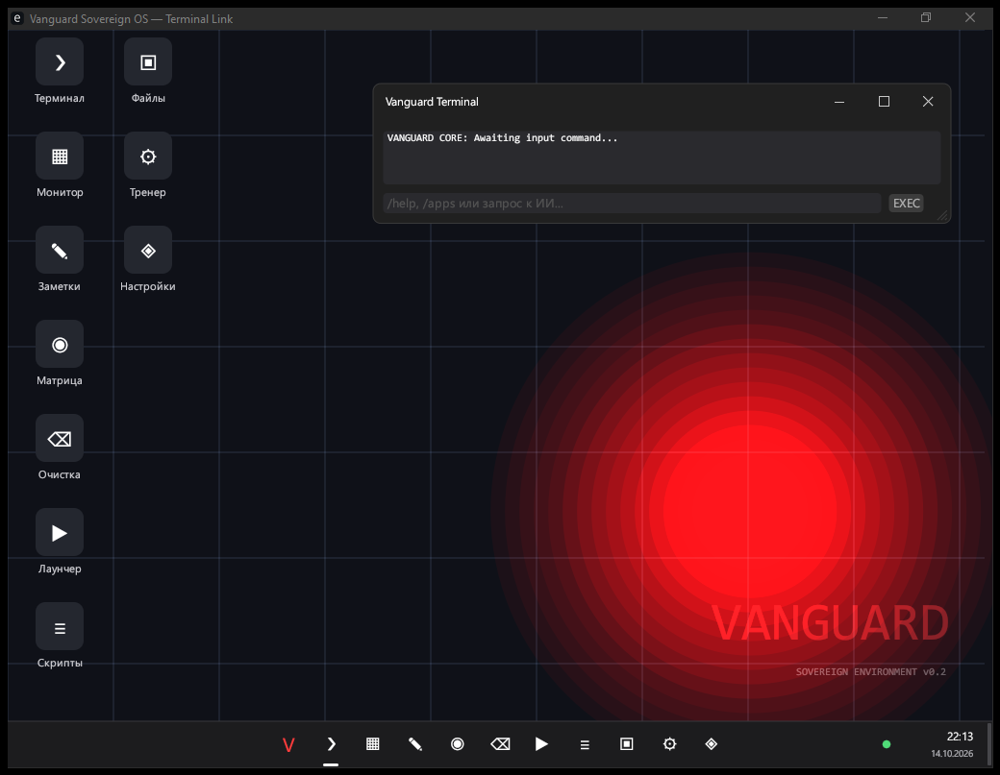
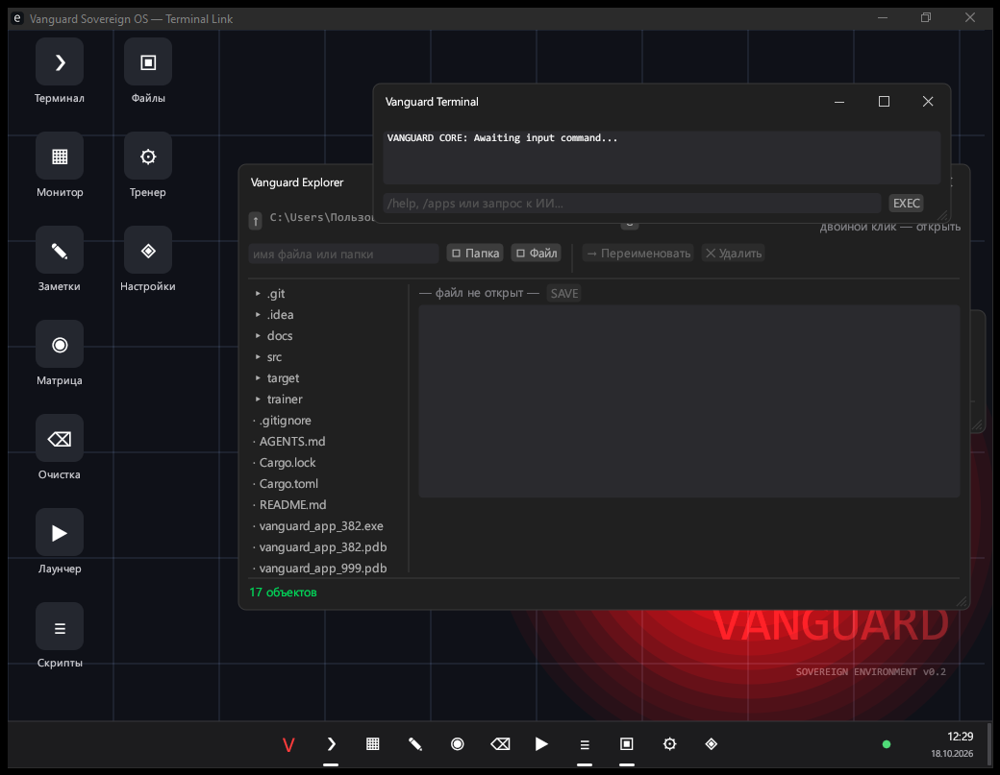
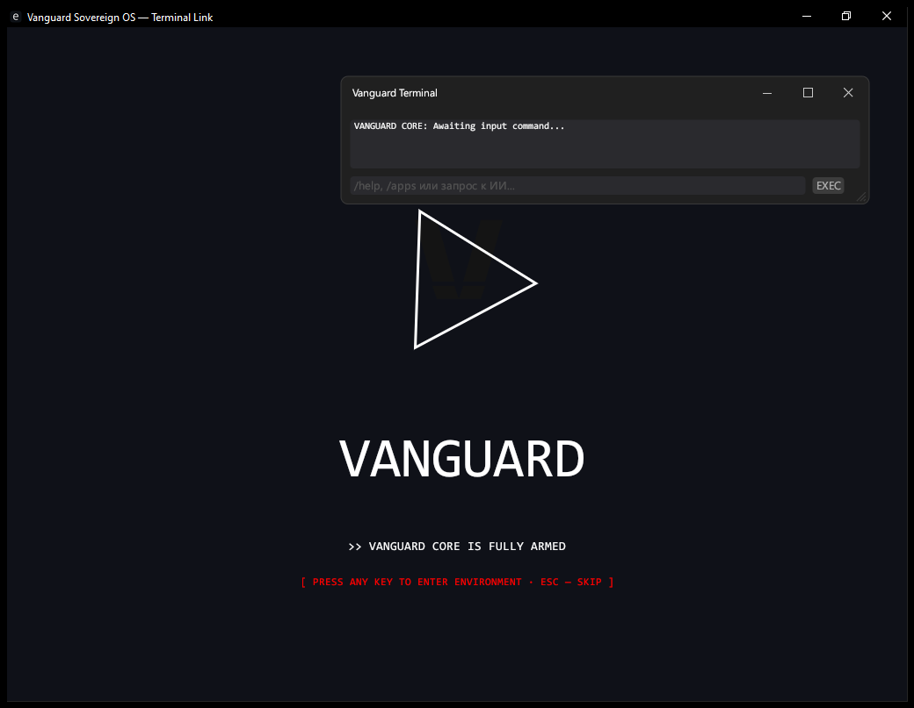

# 🖥️ Vanguard Sovereign OS

> **English:** a Windows-11-styled fake-OS desktop environment written in Rust (eframe/egui) with a
> built-in AI terminal powered by a **local** Ollama model — animated boot splash, a taskbar, ten
> apps, a sandboxed file explorer, and a shell that understands slash-commands, streams answers,
> and generates, compiles and runs code. Two processes: a thin GUI shell and a headless engine
> talking TCP on `127.0.0.1`. Fully offline: no API keys, no cloud, your GPU.

Киберпанк-«фейковая ОС» на Rust с локальным ИИ-терминалом: заставка с глитчами и взрывом,
панель задач с десятью приложениями, проводник с песочницей и шелл, который понимает
слеш-команды, стримит ответы из локальной модели и сам генерирует, компилирует и запускает код.



*Рабочий стол: центрированная панель задач, сетка приложений и локальный ИИ-терминал.*



*Проводник «Файлы»: дерево каталогов песочницы слева, редактор с `SAVE` справа.*



*Заставка в стиле BIOS-POST — `ESC` пропускает.*

## Возможности

- **Заставка** в стиле BIOS-POST: прогресс-бар, логи ядра, глитчи, взрыв логотипа.
  `Enter`/`Пробел` — запустить анимацию, **`ESC` — пропустить** и сразу попасть на стол.
- **Рабочий стол Windows 11**: центрированная панель задач с закреплёнными кнопками окон,
  меню «Пуск», контекстное меню по правой кнопке, календарь по клику на часы, сетка иконок,
  точка статуса бэкенда ИИ, показать-рабочий-стол одним движением.
- **Теневая модель процессов**: GUI-оболочка (`vanguard_os`) и движок (`vanguard_core`) —
  два процесса, общаются JSON-строками по TCP на `127.0.0.1:7331`. Оболочка **сама поднимает
  ядро**, если оно ещё не запущено, так что `cargo run` — единственная команда.
  Компиляция `rustc -O` ушла в ядро именно поэтому: раньше она висела в UI-потоке и
  замораживала рендер на секунды.
- **Терминал ИИ**: SSE-стриминг ответа по мере генерации, память диалога на 12 реплик,
  история команд `↑`/`↓`, `Ctrl+L` — очистить чат, `F1` — справка, `Enter` — фокус в строку.
- **Генерация и исполнение кода**: модель отдаёт JSON-протокол → приложение пишет
  `vanguard_gen_*.py` / `.rs` / `.bat` → компилирует (`rustc -O`, в ядре) и запускает.
- **Проводник «Файлы»**: настоящая файловая система, но только внутри **песочницы ядра** —
  корень = рабочий каталог процесса, каждый путь проверяется через `canonicalize()` и
  `starts_with(root)`, `..` и диски отрезаются на входе. Чтение, запись, папки,
  переименование, удаление дерева — и встроенный редактор с `SAVE`.
- **Окна** (все десять: `Terminal`, `Монитор`, `Заметки`, `Матрица`, `Очистка`, `Лаунчер`,
  `Скрипты`, `Файлы`, `Тренер`, `Настройки`): блокнот с автосейвом, digital rain,
  реестр `/apps`, проводник скриптов с запуском в один клик, монитор CPU/RAM/Disk,
  окно настроек с автозапуском Ollama.
- **Адаптивная раскладка**: окно ресайзится и сворачивается в полноэкранный режим по `F11`;
  геометрия стола, панели задач и попапов каждый кадр читается из реального вьюпорта.
  Опорный размер — 1024×768, он же минимальный.
- **Полностью офлайн**: ни одного внешнего сетевого запроса — модель живёт в вашей VRAM.

## Быстрый старт

### Требования

- **Rust** (`cargo` на PATH) и **Python 3** — рантайм для сгенерированных скриптов;
- **[Ollama](https://ollama.com)** с запущенным демоном (`ollama serve`);
- GPU с **≥ 8 ГБ VRAM**: модель должна целиком помещаться в видеопамять (успевает всё
  до ~11 ГБ). Если она не влезает — Ollama делит её с CPU, и генерация падает примерно
  с ~136 до ~6 токенов/с (замерено на qwen2.5-coder 32b vs 7b).

```bash
git clone https://github.com/sulejmanovdamir057-alt/Vanguard_os.git
cd Vanguard_os
ollama serve        # если Ollama не запущен (на Windows не автозапускается)
cargo run           # первый запрос после старта демона грузит модель ~8 с
```

`cargo run` поднимает только оболочку — ядро она запустит сама при первом обращении.
Запускать два процесса вручную нужно лишь для отладки IPC:
`cargo run --bin vanguard_core` в отдельном окне (займёт `7331` и напечатает в stderr,
если порт занят).

Первый запуск после перезагрузки потребует `ollama serve` один раз — дальше в окне
**Настройки** есть чекбокс автозапуска демона.

### Настройка ИИ (переменные окружения)

| Переменная | Дефолт | Смысл |
|---|---|---|
| `VANGUARD_AI_URL` | `http://localhost:11434/v1/chat/completions` | OpenAI-совместимый эндпоинт |
| `VANGUARD_AI_MODEL` | `qwen3.5:9b` | любой тег Ollama; гибридная модель — см. ниже |
| `VANGUARD_AI_KEY` | `ollama` | уходит в `Bearer`, Ollama его игнорирует |
| `VANGUARD_AI_KEEP_ALIVE` | `30m` | `-1` — **не выгружать модель никогда** (числом, не строкой!) |
| `VANGUARD_AI_REASONING_EFFORT` | — | `none` — выключить «размышление»: **27× быстрее** на длинном промпте |

Две вещи, которые стоят знать:

- **`reasoning_effort: none`** — главное рычаг скорости на гибридных моделях (qwen3.*):
  без него модель уходит в thinking на десятки секунд, с ним — ответ за ~1 с.
  `max_tokens` для этой цели использовать бесполезно: он обрезает ответ раньше, чем
  начнётся текст.
- **`keep_alive: -1`** убирает «зависание первого запроса после простоя»: Ollama по
  дефолту выгружает модель через 30 минут без запросов, а догрузка 6 ГБ стоит ~6.4 с.

Значения в окне **Настройки** перекрывают переменные окружения и сохраняются в
`vanguard_settings.json` (не попадает в git).

## Управление

| Клавиша / команда | Что делает |
|---|---|
| `Enter` (на столе) | фокус в строку ввода |
| `↑` / `↓` | история команд |
| `F1` | `/help` — список команд |
| `Ctrl+L` | очистить чат и память диалога |
| `F11` | полноэкранный режим без рамки (и обратно) |
| `ESC` (на заставке) | пропустить заставку |
| правая кнопка на столе | контекстное меню |
| клик на часах | календарь |
| `/help /apps /run <id> /hardware /wipe /reset /exit` | слеш-команды шелла |
| всё остальное | уходит в локальную модель |

## Архитектура

**Два бинарника и общий крейт** — движок отдельно от графики:

| Цель | Что это |
|---|---|
| `vanguard_os` | оболочка: рендер egui, SSE-стрим ИИ, IPC-клиент. Тонкая обёртка над библиотекой |
| `vanguard_core` | ядро: TCP-сервер на `127.0.0.1:7331` — слеш-команды, `/run`, компиляция `rustc -O`, телеметрия, песочница файлового проводника |
| `vanguard_os_lib` | общий код: протокол IPC, `ai_core`, движок (`core/shell`, `core/executor`, `core/telemetry`) |

Модули библиотеки и оболочки:

| Модуль | Роль |
|---|---|
| `ipc.rs` | только протокол: `Request`/`Response`/`Event` + типы `Fs*`, порт 7331 |
| `ai_core.rs` | SSE-стриминг через `ureq`, env-конфиг, JSON-протокол действий |
| `core/shell.rs` | слеш-команды, диалог (`messages`), исполнение действий ИИ |
| `core/telemetry.rs` | фоновый поток: CPU/RAM/Disk в `Arc<Mutex<SystemMetrics>>` |
| `core/executor.rs` | запуск сгенерированных Python-скриптов |
| `bin/core.rs` | сервер ядра: маршрутизация запросов, фоновые задачи, `sandbox_path()` |
| `ipc_client.rs` | клиент оболочки: соединение, автозапуск ядра, чтение потока событий |
| `app.rs` | цикл `eframe::App`, заставка, окна, стрим ИИ, состояния всех окон |
| `desktop.rs` | весь рабочий стол: обои, иконки, панель задач, «Пуск», календарь |
| `ui_window.rs` | `VanguardWindow`/`WindowId`/`VanguardWindows` — реестр из десяти окон |
| `settings.rs` | настройки: чтение/запись JSON, автозапуск демона Ollama |

Почему процессы разделены, какие есть ловушки и как это отлаживать — в [AGENTS.md](AGENTS.md).

## Самообучение — окно Neural Trainer

Приложение умеет дообучать **свою** модель на **своих же** диалогах:

1. Каждая реплика терминала пишется в `vanguard_dialogues.jsonl` (журнал — Ваши личные
   данные, в git не попадает).
2. Иконка **🧬 TRAINER** открывает окно: укажите модель HuggingFace (дефолт
   `Qwen/Qwen3.5-9B`), жмите «ЗАПУСТИТЬ ДООБУЧЕНИЕ» — в чат польётся лог тренировки.
3. Обучение — QLoRA (4-bit NF4 + LoRA r=16) на PyTorch/CUDA; **база не меняется**,
   адаптеры копятся в `trainer/runs/`, а финальный holdout-loss показывает, было ли
   дообучение полезным (защита от «модель выучила шум своих же ответов»).

Требования: `pip install transformers peft datasets accelerate bitsandbytes` и **CUDA-сборка**
torch (`pip install --index-url https://download.pytorch.org/whl/cu126 --force-reinstall torch` —
PyPI-версия по умолчанию CPU-only!). Во время тренировки модель выгружается из Ollama —
параллельные запросы к ИИ на это время упадут по нехватке VRAM, это нормально.

## Стек

Rust 2021 · [eframe/egui 0.28](https://github.com/emilk/egui) · `ureq` 3.4.2 · `sysinfo` ·
`serde_json` · `chrono` · `glob` · Python как рантайм сгенерированного кода и дообучения
(PyTorch/CUDA, transformers, peft, bitsandbytes).

## Roadmap

- [x] Стриминг ответа, память диалога, история команд
- [x] Адаптивная раскладка под любой размер окна + `F11`
- [x] Автосейв блокнота, пропуск заставки
- [x] Разделение на два процесса (GUI ↔ ядро по TCP)
- [x] Окно настроек и автозапуск демона Ollama
- [x] Проводник «Файлы» с песочницей ядра
- [x] Календарь, меню «Пуск», контекстное меню, панель задач
- [x] Скриншоты в README (рабочий стол, проводник, заставка)
- [ ] Лицензия (MIT)
- [ ] Браузер в отдельном окне (wry + WebView2)
- [ ] Мелкие приложения: калькулятор, диспетчер задач, редактор скриптов
- [ ] Изоляция исполняемого кода ИИ (сейчас `python` и `rustc` запускаются без песочницы —
      песочница есть только у файлового проводника)
- [ ] Английская локализация интерфейса

## Лицензия

Скоро будет указана (MIT/Apache-2.0) — если хотите форкнуть или использовать код,
пока что просто напишите issue.
